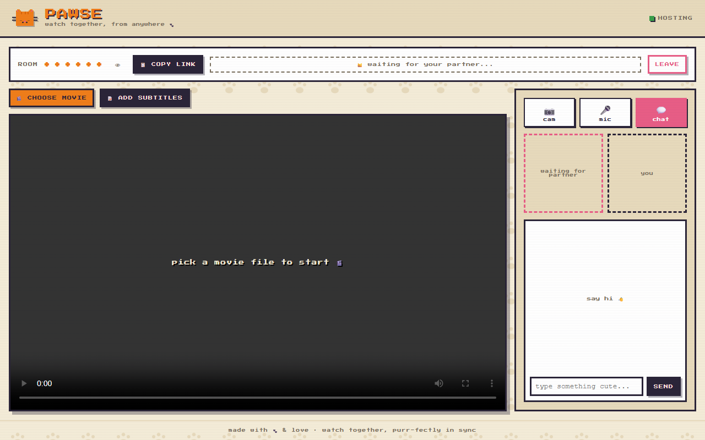
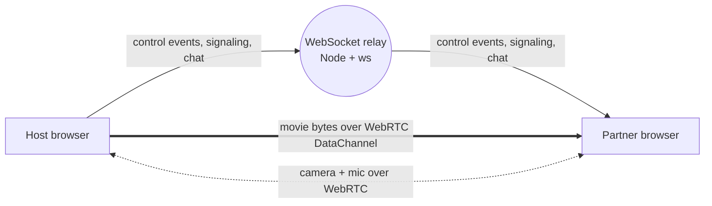

# Pawse

Watch movies together from two places, in sync. One person picks a file, the other opens a link. No accounts, no uploads to a server.

**Live:** https://pawsetv.vercel.app (open it in two windows to try it alone)



## Why

Long-distance movie night usually means "3, 2, 1, play" over a call and drifting apart by the second scene. Screen sharing re-encodes the video and drops quality. Pawse keeps both players on the same timeline and, for your own files, sends the original bytes peer to peer so the partner sees the same quality you do.

## What it does

- **Own-files mode (web player).** The host picks a movie file. It goes to the partner over a WebRTC DataChannel in 16 KB chunks and is reassembled as the exact same file, then both players are driven by the same play / pause / seek events.
- **Together layer.** Camera, mic and chat in the room, plus local subtitle files on each side.
- **YouTube sync (Chrome extension, MV3).** Each side plays its own tab. The extension relays play, pause, seek and video switches, and pauses both sides when one starts buffering.
- **Rooms.** 6-character code or share link, host role with migration if the host drops, a 2-minute grace window so a refresh rejoins the same room, heartbeat to reap dead sockets.

## How it works



- The relay only carries small JSON messages (`control`, `buffer`, `video`, `signal`, `chat`, `presence`). Video never touches the server, so the relay runs on a free tier.
- Rooms live in memory: no database for a room of two. A cap of 500 live rooms protects the public relay.
- Remote commands set a suppress flag so the player events they trigger are not echoed back (no play/pause ping-pong).
- NAT traversal: STUN first, TURN fallback for strict networks.

## Stack

React 18 + Vite (player), Node.js + `ws` (relay), WebRTC (DataChannel, media), Chrome Extension MV3. Player on Vercel, relay on Render.

## Run locally

```bash
# relay on :8080
cd server && npm install && npm run dev

# player on :5173, talks to ws://localhost:8080 by default
cd player && npm install && npm run dev
```

Open http://localhost:5173 in two windows, create a room in one and join from the other. `server/scripts/test-client.js` checks the relay from the command line.

For production set `VITE_RELAY_WS=wss://<your-relay>` on the player build. `render.yaml` deploys the relay as a Render Blueprint.

## Layout

```
server/      WebSocket relay: rooms, roles, broadcast, heartbeat
player/      React web player: file transfer, sync, camera, mic, chat
extension/   Chrome MV3 extension: YouTube and generic <video> sync
docs/        flow and state diagrams, design system, deploy notes
```

## Roadmap

- Clock sync (RTT compensation) and drift correction with playback-rate nudges
- Netflix, Prime Video and JioHotstar adapters for sync-only mode (each side uses its own account; no DRM workarounds)
- Point the extension at the hosted relay
- Shared-file detection to skip the transfer when both sides already have the file

Design notes: [flow diagrams](docs/FLOW-DIAGRAM.md), [state machines](docs/STATE-DIAGRAM.md), [design system](docs/DESIGN.md), [roadmap](ROADMAP.md).
