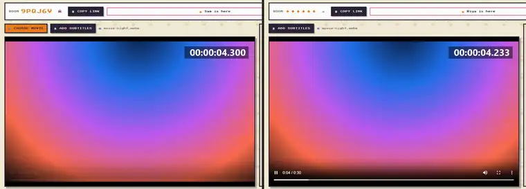
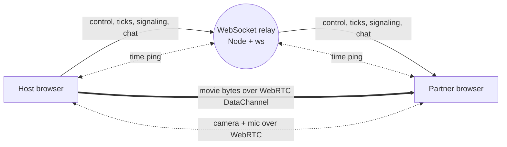

# Pawse

Watch movies together from two places, in sync. One person picks a file, the other opens a link. No accounts, no uploads to a server.

**Live:** https://pawsetv.vercel.app (open it in two windows to try it alone)



[Watch the 15 s launch clip](docs/launch.mp4)

## What it is

Long-distance movie night usually means "3, 2, 1, play" over a call and drifting apart by the second scene. Screen sharing re-encodes the video and drops quality. Pawse keeps two players on one timeline:

- **Your own files.** The host picks a movie. It goes to the partner peer to peer over a WebRTC DataChannel and is rebuilt as the exact same file, so both sides watch original quality.
- **YouTube.** A Chrome extension (MV3) syncs two YouTube tabs. Each side plays its own tab; play, pause, seek, video switches and buffering follow.
- **Together.** Camera, mic and chat in the room, plus local subtitle files on each side.
- **Rooms.** A 6-character code or share link. Host migration if the host drops, a 2-minute grace window so a refresh rejoins the same room.

## How sync stays tight

The sync logic lives in one file, [`extension/sync-core.js`](extension/sync-core.js), shared by the web player and the extension and covered by unit tests.

1. **Shared clock.** Each client pings the relay (5 quick pings on connect, then every 10 s) and keeps the offset from the lowest round-trip sample, NTP style. The fastest sample leaves the least room for an uneven split between the two legs.
2. **Transit compensation.** Every play, pause and seek carries the relay-clock time it happened. The receiver jumps to where the partner is now, `mediaTime + (now - sentAt) * rate`, instead of where they were when they pressed the button.
3. **Drift correction.** While playing, both sides report their position every second. The follower compares it with its own: under 20 ms it does nothing, up to 400 ms it changes `playbackRate` by at most 8% so the gap closes in about 2 s without a visible jump, and beyond that it seeks.

The room shows the live measured gap in a badge (`IN SYNC 12MS`); the extension popup shows the same number.

## Measured

Gap between the two players, in ms. Each cell is the median of 3 runs (steady state, from 2 s after each command); the worst p95 across those runs is in brackets. One frame at 30 fps is 33 ms.

| Scenario (relay delay per direction) | Without: play | Without: after seek | With: play | With: after seek |
|---|---|---|---|---|
| No added delay | 10 (11) | 10 (31) | 11 (11) | 10 (17) |
| 150 ms ± 30 ms | 350 (360) | 350 (380) | **6 (11)** | **13 (31)** |
| 150 ms ± 30 ms, partner clock 0.5% slow | 453 (516), growing | 435 (464) | **19 (35)** | **27 (41)** |
| Extension, 150 ms ± 30 ms | | | 5 (45) | 11 (46) |
| Extension, 150 ms ± 30 ms, 0.5% slow | | | 26 (37) | 18 (32) |

With no added latency the old relay was already close; the engine matters once there is real network delay. Without it, the partner trails by the full one-way trip and, with a skewed clock, keeps falling behind. With it, the median stays under one frame.

How it was measured: [`scripts/measure-sync.mjs`](scripts/measure-sync.mjs) starts a local relay with injected latency, opens host and partner in headless Chromium, streams a test movie and samples both players every 250 ms. Each sample pairs `currentTime` with a high-resolution wall clock taken in the same page, so the harness's own read delay does not count. "Without" is the old behaviour, still available as `?sync=off`. The skew rows force the partner's video clock 0.5% slow, far worse than real hardware, to show the correction loop working against a steady pull.

The extension row comes from [`scripts/measure-extension.mjs`](scripts/measure-extension.mjs): the real `background.js` runs in a Node VM with `chrome.*` stubbed, and the real content script runs in a stand-in YouTube watch page. Chrome's own extension messaging is not covered.

Limits: everything ran on one machine with simulated latency, not two real networks. A one-sided delay (slow upload, fast download) shifts the clock estimate by half the difference, and the loop cannot see that.

## Architecture



- The relay only carries small JSON messages (`time`, `control`, `buffer`, `video`, `signal`, `chat`, `presence`). Video never touches the server, so it runs on a free tier.
- Rooms live in memory: no database for a room of two. A cap of 500 live rooms protects the public relay.
- Remote commands are applied quietly, so the player events they trigger are not echoed back (no play/pause ping-pong).
- In the extension, either side stalling pauses the other until both have buffered.
- NAT traversal: STUN first, TURN fallback for strict networks.

## Stack

React 18 + Vite (player), Node.js + `ws` (relay), WebRTC (DataChannel, media), Chrome Extension MV3. Player on Vercel, relay on Render. Tests use `node:test`; CI runs them and builds the player on every push.

## Run locally

```bash
# relay on :8080
cd server && npm install && npm run dev

# player on :5173, talks to ws://localhost:8080 by default
cd player && npm install && npm run dev
```

Open http://localhost:5173 in two windows, create a room in one and join from the other.

The extension points at the hosted relay. To use a local one, change `RELAY_WS` in `extension/config.js`, then load `extension/` unpacked from `chrome://extensions`.

For production set `VITE_RELAY_WS=wss://<your-relay>` on the player build. `render.yaml` deploys the relay as a Render Blueprint.

## Tests and measurements

```bash
npm test                                            # sync math + relay (run `npm install` in server/ first)
npm install && node scripts/measure-sync.mjs --delay 150 --jitter 30
node scripts/measure-sync.mjs --delay 150 --sync off   # old behaviour, for comparison
node scripts/measure-extension.mjs --delay 150 --skew 0.005
```

The measurement scripts need ffmpeg on PATH (they generate a test movie once).

## Layout

```
server/      WebSocket relay: rooms, roles, clock ping, broadcast, heartbeat
player/      React web player: file transfer, sync, camera, mic, chat
extension/   Chrome MV3 extension: YouTube sync; sync-core.js is shared with the player
scripts/     sync measurements, extension packaging
test/        unit tests for the sync math
docs/        flow and state diagrams, design system, deploy notes
```

## Roadmap

- Netflix, Prime Video and JioHotstar adapters for sync-only mode (each side uses its own account; no DRM workarounds)
- YouTube ads: sync pauses its reports during an ad, but the two sides' ads are not lined up yet
- Shared-file detection to skip the transfer when both sides already have the file
- Chrome Web Store listing (load unpacked for now)

Design notes: [flow diagrams](docs/FLOW-DIAGRAM.md), [state machines](docs/STATE-DIAGRAM.md), [design system](docs/DESIGN.md), [roadmap](ROADMAP.md).
