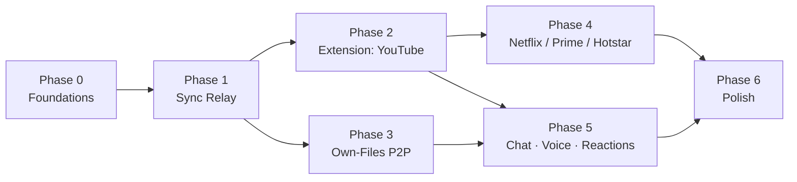

# Pawse — Roadmap

> Personal project: watch movies/videos/music **in perfect sync** with one remote partner, for free, self-hosted, no third-party extension dependency.
>
> **Ground rule baked into every phase:** we never move video between the two of you for DRM services. We sync *control events* (`play` / `pause` / `seek`) over WebSocket — a few bytes, millisecond latency. For DRM platforms (Netflix, Prime, Hotstar, Hulu) both sides need their own login; the DRM pipeline (EME/Widevine + HDCP) makes re-streaming physically return a black screen, so it is out of scope permanently, not just for v1. For **non-DRM content** (your own files, free/YouTube video) only one host is needed and the video itself can stream peer-to-peer.

## The two operating modes

Pawse ships **both**. The mode is chosen automatically by whether the source is DRM-protected:

| | **Mode A — Sync** (Track A, DRM platforms) | **Mode B — P2P Stream** (Track B, non-DRM) |
|---|---|---|
| Content | Netflix, Prime, JioHotstar, Hulu | Own files, YouTube, any free/non-DRM video |
| **Accounts** | **Both** partners log in (plans may differ — 4K vs 480p is fine) | **One** host is enough; partner joins with no account |
| What crosses the wire | Only control events; each side plays its own stream | The actual video, host → partner over WebRTC |
| Why | DRM forbids re-streaming (black screen); so we sync the timeline | No DRM — the host can legitimately stream their own source |

Both modes reuse the **same relay (Phase 1), same protocol, same drift engine.** Everything below is built once and serves both.

---

## Phase 0 — Foundations (Day 1–2)

**Goal:** repo, tooling, deploy pipeline. Nothing user-visible yet.

| # | Task | Notes |
|---|------|-------|
| 0.1 | Monorepo scaffold | `server/` (Node), `extension/` (MV3), `player/` (static web app), `shared/` (protocol types) |
| 0.2 | Define the **sync protocol v1** | Single JSON message schema shared by every client (see FLOW-DIAGRAM.md §2) |
| 0.3 | Free-tier deploy target | Render / Railway / Fly free tier for the WS server; GitHub Pages or Vercel for the static player |
| 0.4 | CI | GitHub Actions: lint + typecheck + deploy on push to `main` |

**Exit criteria:** `wss://…/health` returns 200 from the deployed free-tier server.

---

## Phase 1 — Sync Relay Server (Day 2–4) ← the spine

**Goal:** rooms + broadcast. Everything else plugs into this.

| # | Task | Notes |
|---|------|-------|
| 1.1 | WebSocket server (`ws` on Node) | No DB. Rooms live in memory — fine for 2 users |
| 1.2 | Room lifecycle | `create` → 6-char share code → `join` → destroy when empty (grace timer for refreshes) |
| 1.3 | Roles | First joiner = **host** (source of truth). Host migration if host disconnects |
| 1.4 | Broadcast control events | Relay `{action, mediaTime, sentAt}` to all room peers |
| 1.5 | Clock sync | Ping/pong RTT measurement so clients can compensate latency when applying a seek |
| 1.6 | Heartbeat / presence | Detect dead sockets, notify partner "she disconnected" |
| 1.7 | Free-tier cold-start handling | Render free tier sleeps; client shows "waking server…" and retries with backoff |

**Exit criteria:** two browser tabs joined to one room echo play/pause to each other in <200 ms.

---

## Phase 2 — Track A / Mode A: Browser Extension, YouTube first (Week 1–2)

**Goal:** the Teleparty-killer, proven on the easiest (DRM-free) platform. YouTube needs **no account** either side; the same extension later handles DRM platforms where **both** log in.

| # | Task | Notes |
|---|------|-------|
| 2.1 | MV3 extension scaffold | Popup UI (create/join room), background service worker (owns the WS), content script (owns the `<video>`) |
| 2.2 | Video adapter: generic `HTMLMediaElement` | Listen `play/pause/seeking`, command `.play()/.pause()/.currentTime=` |
| 2.3 | **Echo suppression** | The #1 sync bug: applying a remote event fires local events → infinite loop. Tag programmatic actions and swallow them |
| 2.4 | Drift correction loop | Every 5 s compare timestamps; drift > 1 s → soft-seek the follower; > 0.3 s → nudge `playbackRate` (1.05×/0.95×) so no visible jump |
| 2.5 | YouTube adapter | Handle ads (pause sync during ads), SPA navigation (video element replaced without page load) |
| 2.6 | Share link flow | `Create room` → copies `youtube.com/watch?v=…#wp=ROOMCODE` → her extension auto-joins |

**Exit criteria:** you and your girlfriend watch a full YouTube video, either can pause/seek, drift never exceeds 1 s.

---

## Phase 3 — Track B / Mode B: Own-Files P2P Player (Week 2–3)

**Goal:** the fully independent path — your files, no platform, no subscription, nothing to bypass. **Quality is non-negotiable here: the partner must see the file at its native quality, identical to the host — never a re-encoded, degraded live stream.**

### Quality strategy — the core decision

We transfer the **original file bytes**, never a re-encoded video track. Three tiers, best first:

| Tier | When | How | Quality |
|---|---|---|---|
| **B0 — Shared local file** | Both already have the same file | No streaming at all — each plays their own local copy; Pawse syncs only control events (like Mode A, but free, no account) | **Perfect** — native, bit-for-bit, zero network quality loss |
| **B1 — File transfer + MSE** | Only the host has the file | Host sends the *actual file bytes* in chunks over the WebRTC **DataChannel**; partner feeds them to **Media Source Extensions** and plays the original file locally | **Lossless** — same bytes decoded on both sides; identical quality, no adaptive downgrade |
| **B2 — Live captureStream (fallback only)** | B1 impossible (e.g. exotic container, weak device) | `captureStream()` re-encoded WebRTC track | Adaptive/degradable — **avoided** unless nothing else works |

The default is **B1**, which sidesteps WebRTC's adaptive-bitrate degradation entirely — the partner isn't watching a stream *of* the video, they're playing the *actual file* as it arrives.

### Zero-buffer strategy — beat the quality-vs-buffering trade-off

Live-streaming native quality in real time only stays smooth if **host upload speed > file bitrate**. Often it isn't. So we don't fight that during the movie — we design it away:

- **Pre-load for planned dates (the hero path → B0).** A date night is scheduled, so Pawse transfers the file to the partner *in the background beforehand* (minutes or hours ahead). At showtime the whole file is local → **zero buffering, native quality, instant seek** — nothing streams during the movie, we only sync play/pause. Strictly better than live-streaming on every axis.
- **Bandwidth check up front.** Measure host upload vs file bitrate. If the pipe can't sustain real-time, Pawse *recommends pre-loading* rather than silently stuttering through the date.
- **Lead buffer for spontaneous nights (B1).** Download runs 60–90 s ahead of the playhead; a "both ready" gate holds playback until each side has a safe cushion, so mid-movie stalls are rare.
- **Direct P2P first.** The STUN direct path is far lower-latency than the relay fallback — prefer it; only relay when NAT forces it.
- **Never buffer by downgrading.** When a stall is unavoidable it's a brief pause-and-refill, never a quality drop.

| # | Task | Notes |
|---|------|-------|
| 3.1 | Static player page | Plain `<video>` + room UI, hosted free (GitHub Pages/Vercel) |
| 3.2 | Signaling over the relay | Host/partner exchange WebRTC offer/answer via the *same* WS server |
| 3.3 | **B1 chunked file transfer** | Host reads file in chunks → DataChannel → partner buffers → MSE `SourceBuffer`. Bit-identical, native quality |
| 3.4 | **B0 shared-file detection** | Hash-match the file on both sides; if partner has it, skip transfer → each plays local copy at full quality |
| 3.4b | **Background pre-load for scheduled dates** | On a "movie date" invite, start transferring the file to the partner immediately so it's fully local by showtime → B0 zero-buffer path |
| 3.4c | **Upload-vs-bitrate check** | Measure host upload; if < file bitrate, prompt "pre-load recommended" instead of stuttering live |
| 3.5 | Lead buffer + both-ready gate | B1 downloads 60–90 s ahead of playhead; playback holds until both sides have a cushion. Adaptive *buffering*, never adaptive *quality* — dips pause-and-refill, never downgrade. Buffer-health bar visible |
| 3.6 | Seek handling | Seeking requests the byte range for that timestamp; MSE appends it — quality unchanged after any seek |
| 3.7 | STUN/TURN | Free STUN (Google). Hostile NATs → relay chunks through WS server (slower, but bytes are still lossless — quality preserved, only speed drops) |
| 3.8 | Subtitle support | Load `.srt/.vtt` locally on each side, synced by the same clock |
| 3.9 | Same sync protocol | Play/pause/seek events identical to Track A — one protocol, two frontends |

**Exit criteria:** you press play on a local `.mp4`; she sees it at **the exact same quality you do** (verified by frame/resolution check), with subtitles, in sync. Quality never drops mid-movie — under load it buffers, it does not downgrade. For a **pre-loaded** date, a full movie plays with **zero buffering events** end to end.

---

## Phase 4 — More Platform Adapters (Week 3–4)

**Goal:** extend Track A to the paid platforms — *sync-only*, both logged in with their own accounts.

| # | Task | Notes |
|---|------|-------|
| 4.1 | Netflix adapter | Netflix ignores raw `video.currentTime` writes — must drive its player API from the page context (injected script) |
| 4.2 | Prime Video adapter | Standard `<video>`, but ad/preview handling |
| 4.3 | JioHotstar adapter | SPA navigation + live-content edge cases |
| 4.4 | Adapter registry | Per-domain adapter selection; generic `HTMLMediaElement` as fallback → many random sites work for free |
| 4.5 | "Both ready" gate | Playback starts only when both sides report the correct title/URL loaded |

**Exit criteria:** synced Netflix session with both accounts, drift < 1 s across a full episode.

**Not building (already solved, DRM'd, or both):** Spotify → use built-in **Jam**; Discord → built-in Watch Together/screen share. A music-sync mode for local audio files falls out of Track B for free.

---

## Phase 5 — The Together Layer (Week 4–5)

**Goal:** the reason you're doing this — presence, voice, faces, reactions.

| # | Task | Notes |
|---|------|-------|
| 5.1 | Text chat | Same WS channel, overlay sidebar in extension + player |
| 5.2 | Voice/video call | WebRTC A/V between you two, PiP draggable overlay; camera bubble over the movie |
| 5.3 | Emoji reactions | Floating hearts/laughs over the video, broadcast via WS |
| 5.4 | Presence UX | "She's here", "she paused", "she's buffering (auto-paused for you)" |
| 5.5 | Scheduled dates | "Movie Friday 9 PM" → link that pre-opens the room |

**Exit criteria:** full movie night — video call bubble + chat + reactions — without opening any other app.

---

## Phase 6 — Polish & Hardening (ongoing)

- Reconnect resume (refresh mid-movie → rejoin at same timestamp)
- Buffer-aware sync (follower buffering → auto-pause host, auto-resume)
- Room passwords (it's just for you two)
- Extension packaging (load-unpacked for both of you; Chrome Web Store optional later)
- Metrics overlay (RTT, drift, buffer) for debugging across her network vs yours

---

## Dependency graph (build order)

