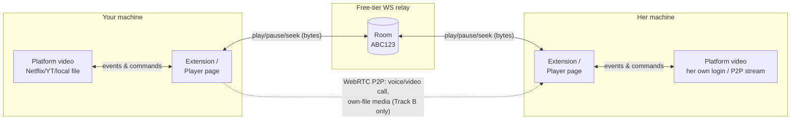
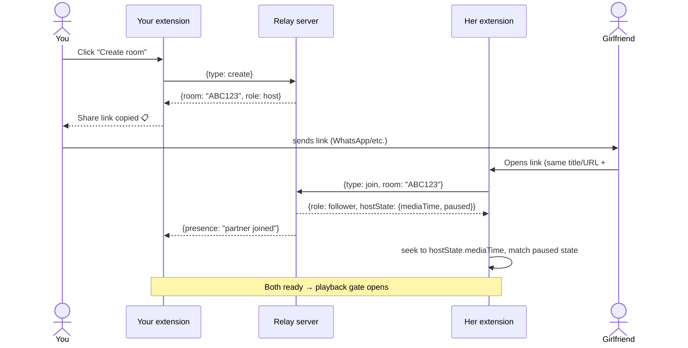
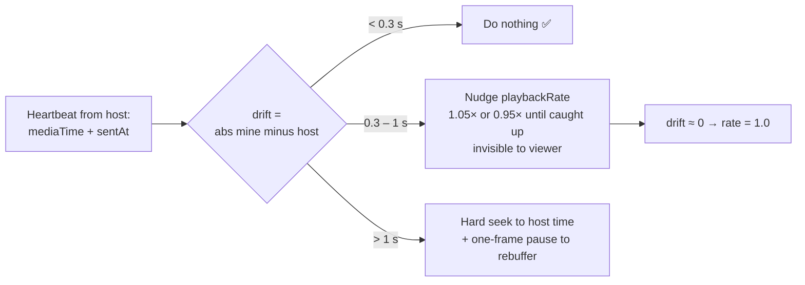
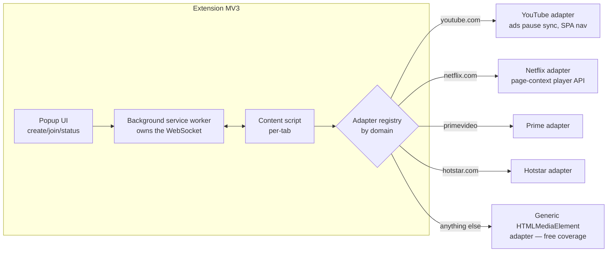
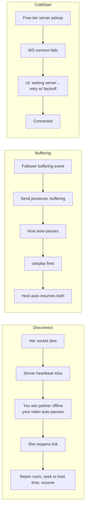

# Pawse — Flow Diagrams

All diagrams are Mermaid — GitHub renders them natively.

---

## 1. Big picture — what travels where

The core trick: **video never travels between you two on DRM platforms.** Only tiny control messages do. Each side plays its own stream; the relay keeps the two players honest.



---

## 2. Sync protocol v1 — the message

One schema for every client (extension, player page):

```jsonc
{
  "type": "control",            // control | chat | presence | signal | clock
  "room": "ABC123",
  "sender": "uuid",
  "action": "play",             // play | pause | seek | rate
  "mediaTime": 872.4,           // video.currentTime when the action happened
  "sentAt": 1721990000000,      // sender's clock (ms)
  "seq": 42                     // monotonic, drop stale/out-of-order events
}
```

---

## 3. Room creation & join



---

## 4. Playback sync loop (the heart)

Either of you can control; the event fans out through the relay. **Echo suppression** is what stops the infinite loop.

```mermaid
sequenceDiagram
    participant YV as Your <video>
    participant YE as Your client
    participant WS as Relay
    participant HE as Her client
    participant HV as Her <video>

    YV->>YE: 'pause' event (user pressed space)
    YE->>YE: is this echo of a remote command? NO → forward
    YE->>WS: {action: pause, mediaTime: 872.4, seq: 42}
    WS->>HE: broadcast to room (not back to sender)
    HE->>HE: seq newer? clock-compensate mediaTime
    HE->>HE: set suppressNext = true
    HE->>HV: video.pause(); currentTime = 872.4 + rtt/2
    HV->>HE: 'pause' event fires
    HE->>HE: suppressNext? YES → swallow, don't rebroadcast ✅
```

---

## 5. Drift correction (runs every 5 s)

Clocks and buffering pull two players apart even with perfect events. The follower self-corrects against the host's heartbeat:



---

## 6. Track A — extension internals (per platform)



---

## 7. Track B — own-file P2P session

```mermaid
sequenceDiagram
    actor You
    participant P1 as Your player page
    participant WS as Relay (signaling only)
    participant P2 as Her player page
    actor GF as Girlfriend

    You->>P1: Pick movie.mp4 (file input, stays local)
    P1->>WS: create room → code
    GF->>P2: open player link, join code
    P1->>WS: file hash
    WS->>P2: file hash
    alt Partner already has the file (B0 — best)
        P2->>P2: load own local copy → native quality, no transfer
    else Partner lacks it (B1 — lossless transfer)
        P1->>WS: WebRTC offer (SDP)
        WS->>P2: forward offer
        P2->>WS: answer + ICE candidates
        WS->>P1: forward
        Note over P1,P2: P2P link up (STUN; WS-relay fallback = slower, still lossless)
        P1->>P2: ORIGINAL file bytes, chunked over DataChannel
        P2->>P2: append to MSE SourceBuffer → plays original file
    end
    P1->>WS: control events (same protocol as Track A)
    WS->>P2: control events
    Note over P1,P2: Partner sees IDENTICAL native quality · never re-encoded · subtitles local each side
```

---

## 8. Failure & recovery flows


