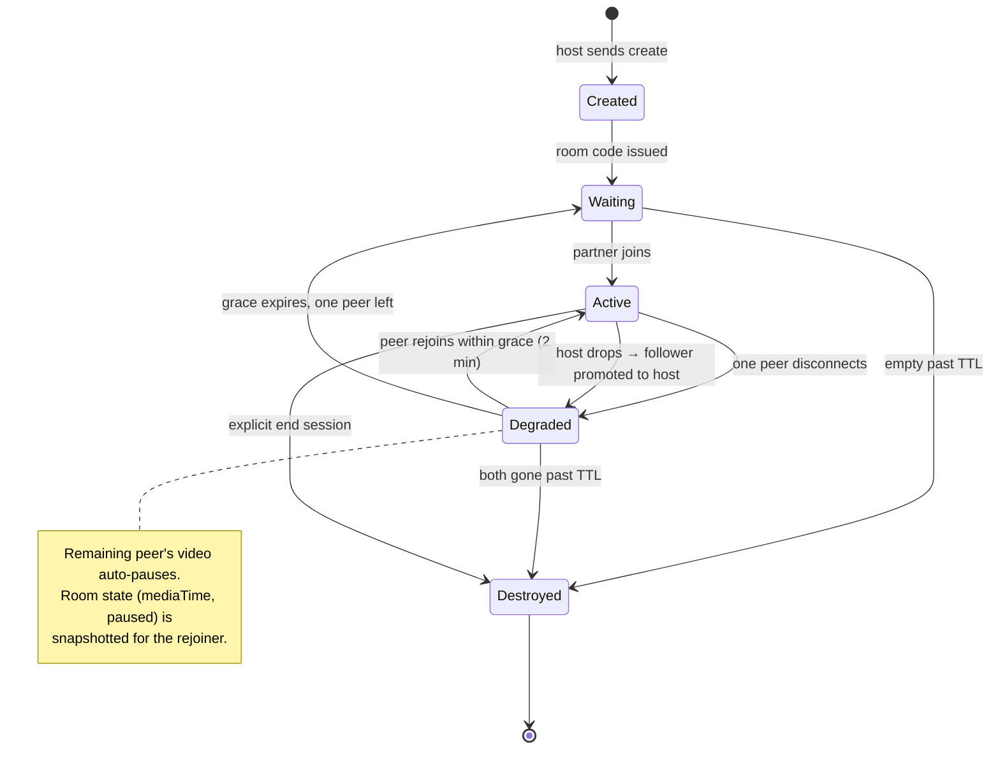
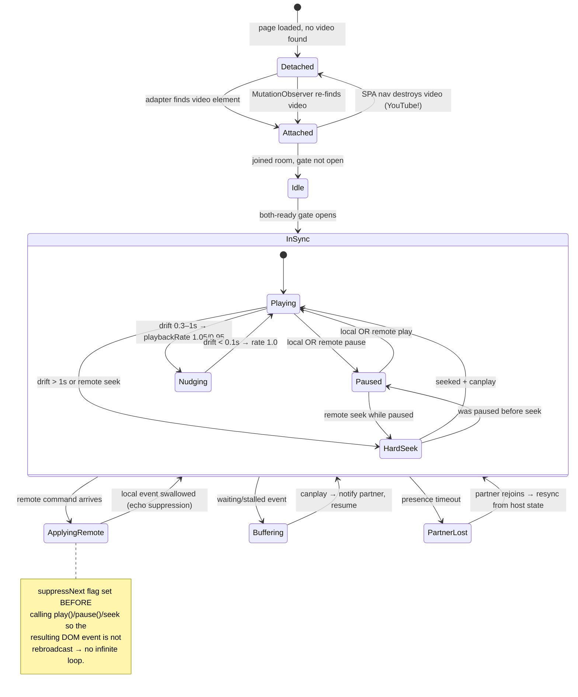
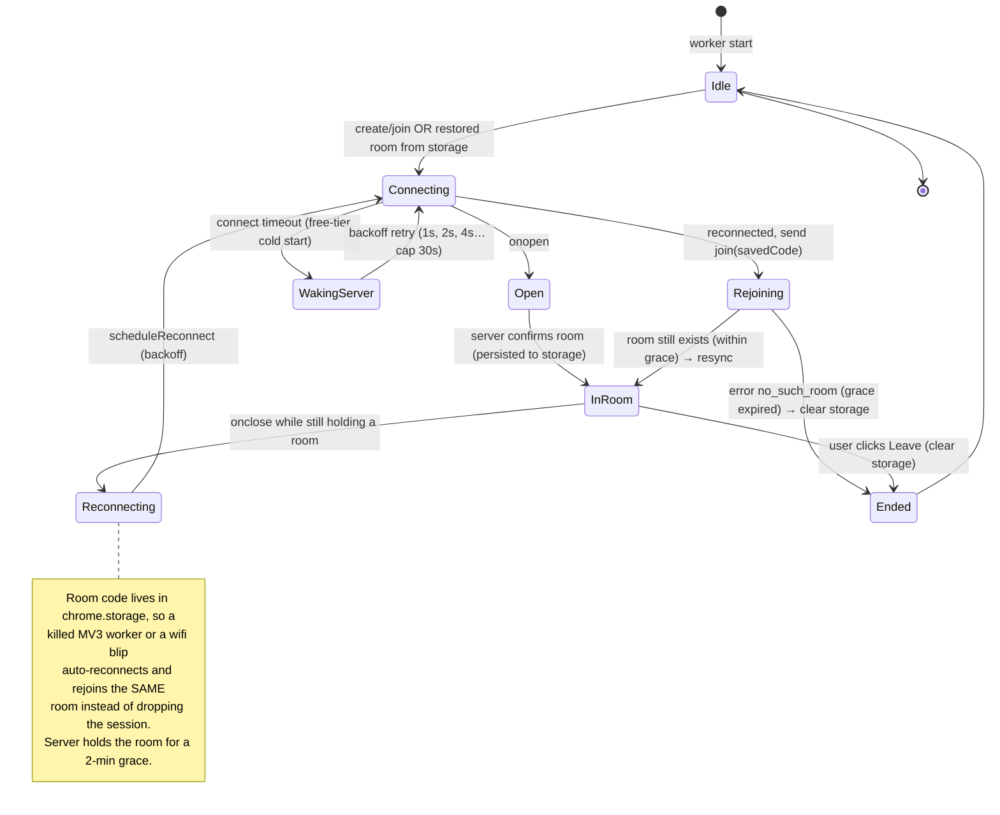
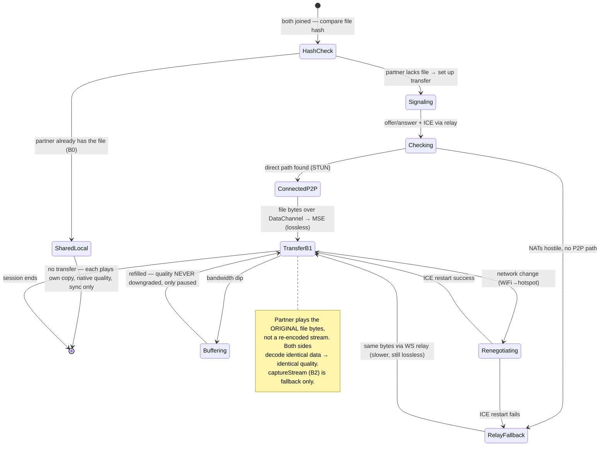

# Pawse — State Diagrams

The three state machines that make sync bug-free. Most watch-party bugs are one of these machines being implicit instead of explicit — so we make them explicit from day one.

---

## 1. Room lifecycle (server side)

---

## 2. Client player state machine (extension content script / player page)

This is the machine that prevents echo loops and drift fights. A client is *always* in exactly one of these states.

---

## 3. WebSocket connection + session (every client) — ✅ implemented in background.js

> Clock-sync ping/pong (RTT compensation) is deferred — not yet in the machine above.

---

## 4. Track B — WebRTC peer connection (own-files mode only)

