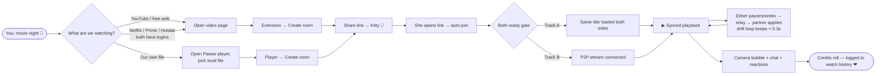
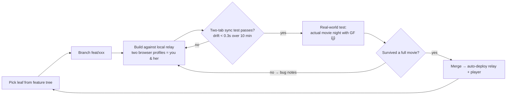

# Pawse — Feature Tree & Master Workflow

## 1. The horizontal feature tree

Everything Pawse is or will be, left → right: product → tracks → capabilities → sub-features. Each leaf maps to a roadmap phase (tagged `P#`).

```mermaid
graph LR
    PAWSE((🐾 Pawse))

    PAWSE --> CORE[Sync Core P1 ✅]
    PAWSE --> TA[Track A<br/>Platform Sync P2 ✅ / P4]
    PAWSE --> TB[Track B<br/>Own-Files P2P P3]
    PAWSE --> TOG[Together Layer P5]
    PAWSE --> INFRA[Infra & Ops P0/P6]
    PAWSE --> MON[Monetization P7]

    %% ---- Sync Core ----
    CORE --> C1[Rooms ✅]
    C1 --> C1a[6-char share codes ✅]
    C1 --> C1b[Host / follower roles ✅]
    C1 --> C1c[Host migration ✅]
    C1 --> C1d[Rejoin grace window ✅ 2min]
    CORE --> C2[Control protocol ✅]
    C2 --> C2a[play / pause / seek / rate ✅]
    C2 --> C2b[seq ordering, stale-drop]
    C2 --> C2c[Echo suppression ✅]
    C2 --> C2f[Video-follow: sync videoId ✅]
    CORE --> C3[Time discipline]
    C3 --> C3a[RTT clock sync]
    C3 --> C3b[Drift nudge via playbackRate]
    C3 --> C3c[Hard-seek threshold]
    CORE --> C4[Presence ✅]
    C4 --> C4a[Heartbeats ✅]
    C4 --> C4b[Buffering → auto-pause partner ✅]
    C4 --> C4c[Disconnect → auto-pause ✅]
    C4 --> C4d[Reconnect + auto-rejoin ✅]

    %% ---- Track A ----
    TA --> A1[MV3 Extension ✅]
    A1 --> A1a[Popup: create/join/leave ✅]
    A1 --> A1b[BG worker owns WS + media cache ✅]
    A1 --> A1c[Content script per tab ✅]
    A1 --> A1d[Persist room + reconnect ✅]
    TA --> A2[Adapter registry]
    A2 --> A2a[YouTube ✅ SPA nav<br/>ad-pause TODO]
    A2 --> A2b[Netflix<br/>page-context player API]
    A2 --> A2c[Prime Video]
    A2 --> A2d[JioHotstar]
    A2 --> A2e[Generic HTMLMediaElement<br/>= free coverage of random sites]
    TA --> A3[Join UX]
    A3 --> A3a[Share link with #pawse hash]
    A3 --> A3b[Both-ready gate]
    A3 --> A3c[Same-title verification]

    %% ---- Track B ----
    TB --> B1[Static player page]
    B1 --> B1a[Local file input<br/>file never uploaded]
    B1 --> B1b[Subtitles .srt/.vtt]
    TB --> B2[P2P transport<br/>quality-first]
    B2 --> B2a[B0: shared local file<br/>each plays own copy = native quality]
    B2 --> B2b[B1: file-byte transfer + MSE<br/>lossless, identical both sides]
    B2 --> B2c[B2: captureStream<br/>fallback only, avoided]
    B2 --> B2d[Adaptive buffering NOT quality<br/>dip → pause+buffer, never downgrade]
    B2 --> B2e[STUN → relay fallback<br/>bytes stay lossless]
    TB --> B4[Zero-buffer engine]
    B4 --> B4a[Pre-load for scheduled dates<br/>= B0 zero buffering at showtime]
    B4 --> B4b[Upload-vs-bitrate check<br/>recommend pre-load if pipe too thin]
    B4 --> B4c[60–90s lead buffer + both-ready gate]
    B4 --> B4d[Direct P2P preferred over relay<br/>lower latency]
    TB --> B3[Music mode]
    B3 --> B3a[Local audio files synced<br/>Spotify itself → use Jam]

    %% ---- Together layer ----
    TOG --> T1[Chat]
    T1 --> T1a[Text sidebar]
    T1 --> T1b[Emoji reactions overlay]
    TOG --> T2[Call]
    T2 --> T2a[WebRTC voice]
    T2 --> T2b[Camera PiP bubble 🐱]
    TOG --> T3[Rituals]
    T3 --> T3a[Scheduled movie dates]
    T3 --> T3b[Watch history<br/>e.g. 42 movies together]

    %% ---- Infra ----
    INFRA --> I1[Free hosting]
    I1 --> I1a[WS relay: Render/Fly/Railway]
    I1 --> I1b[Player: GitHub Pages/Vercel]
    I1 --> I1c[Cold-start wake UX]
    INFRA --> I2[Quality]
    I2 --> I2a[CI lint+typecheck+deploy]
    I2 --> I2b[Debug overlay: RTT/drift/buffer]
    I2 --> I2c[Room passwords]

    %% ---- Monetization (future, P7) ----
    MON --> M1[Tiers]
    M1 --> M1a[Kitten Free forever<br/>room of 2, core]
    M1 --> M1b[Tabby Plus<br/>groups up to 4, packs]
    M1 --> M1c[Panther Pro<br/>groups 10, 4K, custom link]
    M1 --> M1d[Nine Lives Lifetime<br/>anchor + cashflow]
    MON --> M2[Billing spine]
    M2 --> M2a[Razorpay India + Stripe intl]
    M2 --> M2b[DB enters: users/subs/entitlements]
    M2 --> M2c[Gate on entitlement flags]
    MON --> M3[Growth]
    M3 --> M3a[Contextual upsell at friction]
    M3 --> M3b[Referral: invite → both get Plus]
    M3 --> M3c[Wrapped recap → viral share]
    M3 --> M3d[Cosmetics: cat packs impulse buys]
```

> Monetization detail (pricing, tactics, legal): see **[MONETIZATION.md](MONETIZATION.md)**.

---

## 2. Master workflow — a movie night, end to end

---

## 3. Development workflow (how we ship each feature)

Your girlfriend is the QA department. Every feature graduates only after one real movie night.
